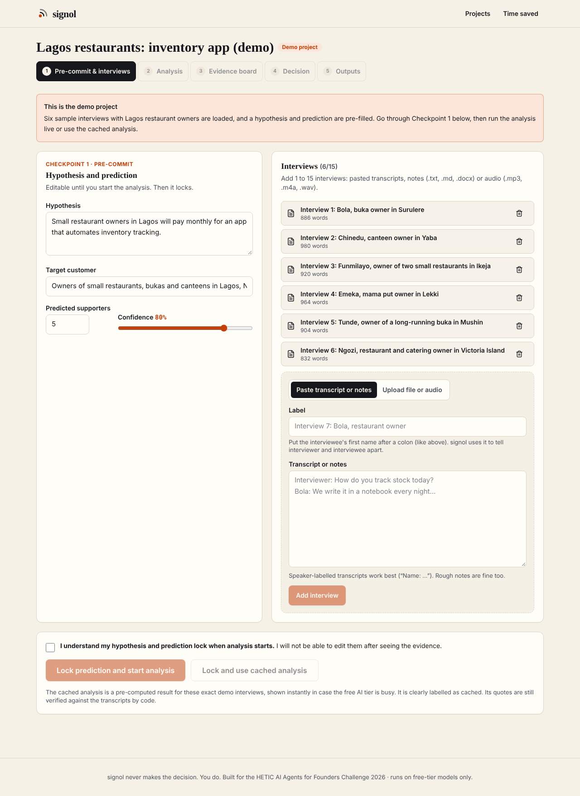
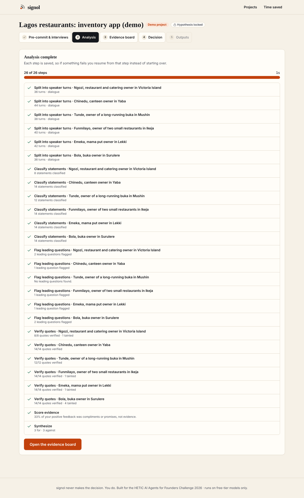
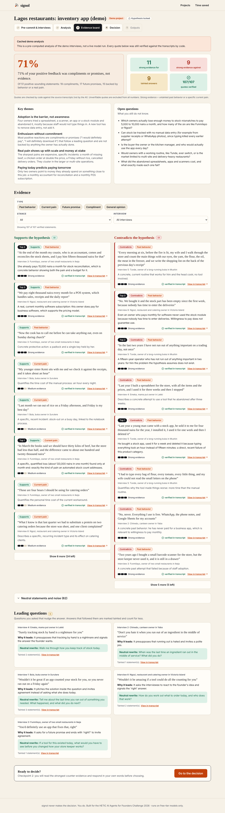
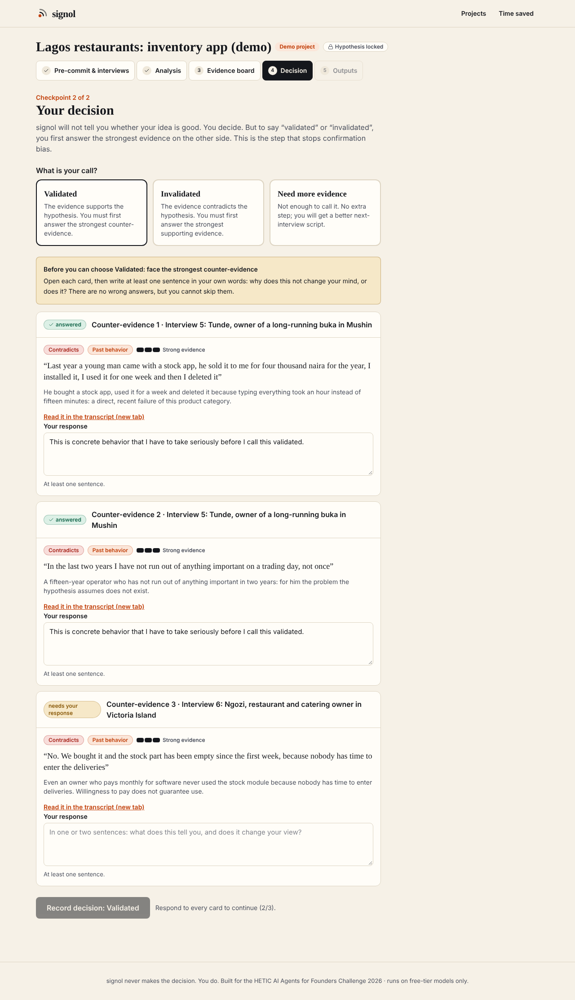
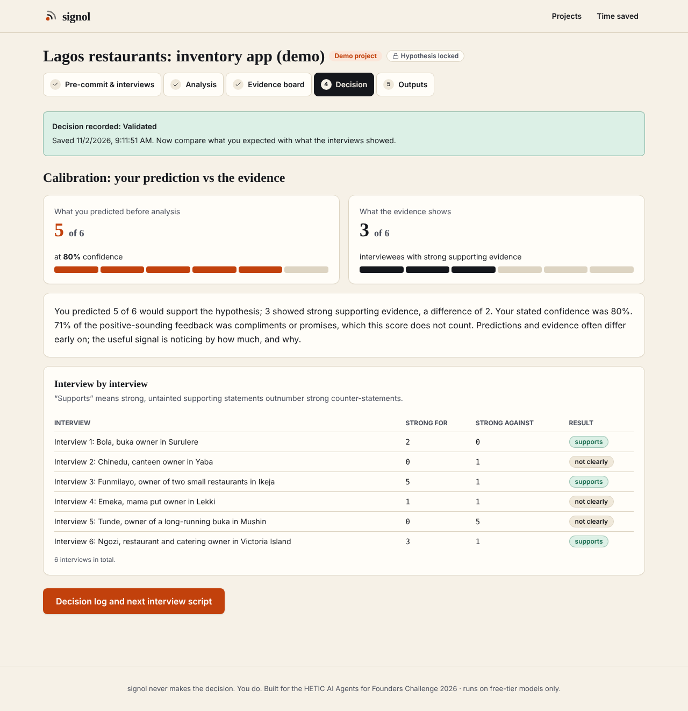

# signol

**Turn customer interviews into an evidence-backed verdict, and face the evidence against you before you decide.**

signol is built for the HETIC *AI Agents for Founders Challenge 2026*. After customer interviews, founders spend 6 to 10 hours rereading notes and still count "great idea!" as validation. signol does the synthesis in minutes, separates real behavior from compliments and promises, flags leading questions, proves every quote exists, and then makes the founder read and answer the strongest counter-evidence before choosing **Validated**, **Invalidated** or **Need more evidence**.

> signol never makes the decision. The founder does, at two explicit human checkpoints.

- **Live demo:** `https://YOUR-DEPLOYMENT.vercel.app` *(placeholder: fill in after deploying; see "Deploy")*
- **Try it without signing up:** click **Try the demo** on the landing page.
- Free models only: Groq (Llama + Whisper) with automatic fallback to Google Gemini Flash.

| | |
|---|---|
|  |  |
|  |  |
|  |  |

Screenshots 04 to 08 show the *cached* demo analysis (curated content, labelled as cached in the app); screenshot 03 is a live pipeline run against the offline test fakes, not a real model.

## How it works

1. **Pre-commit (Checkpoint 1).** Write the hypothesis and predict how many interviewees will support it and how confident you are. This locks when analysis starts (enforced in the database, not just the UI).
2. **Upload.** 1 to 15 interviews: pasted transcripts, notes (`.txt`, `.md`, `.docx`) or audio (`.mp3`, `.m4a`, `.wav`, transcribed with Whisper). Files go to a private Supabase bucket.
3. **Analysis (the agent).** Per interview: split into speaker turns (asks you to confirm who the interviewer is if unclear) → classify each statement (`past_behavior`, `current_pain`, `future_promise`, `compliment`, `opinion_general`) with stance and a verbatim quote → flag leading questions and taint the answers that followed → **verify every quote in code** → **score in code** → one synthesis call over the verified evidence only.
4. **Evidence board.** Headline stat ("71% of your positive feedback was compliments or promises, not evidence"), For/Against columns with quote, type, strength and a "view in transcript" link that highlights the exact quote, leading-question panel with neutral rewrites, filters by type, stance and interview.
5. **Decision (Checkpoint 2).** To choose *Validated* you must open and answer the 3 strongest counter-evidence cards; to choose *Invalidated*, the 3 strongest supporting cards. The server enforces this. Afterwards you see a neutral calibration of your prediction against the evidence.
6. **Outputs.** Decision log (Markdown, PDF, read-only share link), a next-interview script (leading questions rewritten + 3 to 5 new past-behavior questions), and measured time saved (`/stats`, optional benchmark mode).

## Quick start (local)

Requirements: Node 20+ (tested on 22), a free [Supabase](https://supabase.com) project, and at least one free model key.

```bash
git clone <this repo> signol && cd signol
npm install --legacy-peer-deps   # a few dev tools declare conflicting peer ranges
cp .env.example .env.local        # then fill in the values (see below)
```

### 1. Supabase setup

1. Create a project at supabase.com (free tier).
2. **Authentication → Sign In / Providers → enable "Allow anonymous sign-ins".** signol needs no accounts.
3. Apply the schema, either way:
   - SQL Editor: paste and run `supabase/migrations/20260101000000_init.sql`, then `supabase/migrations/20260101000001_storage.sql`; or
   - CLI: `supabase link --project-ref <ref> && supabase db push`.
4. Copy **Project URL** and the **anon** key (Project settings → API) into `.env.local`.

### 2. Model keys (free tiers, no card)

- Groq: <https://console.groq.com/keys> → `GROQ_API_KEY`
- Google AI Studio (Gemini): <https://aistudio.google.com/apikey> → `GEMINI_API_KEY`

Model IDs are configuration (`GROQ_CHAT_MODEL`, `GROQ_WHISPER_MODEL`, `GEMINI_MODEL`), not code. The defaults were **not** verified against the providers' live documentation while building (those sites were not reachable from the build environment), so check them against each provider's current free-tier model list if a call is rejected.

### 3. Run

```bash
npm run dev      # http://localhost:3000
```

Click **Try the demo**, lock the prediction, run the live analysis or use the cached one.

### No Docker / no Supabase account? Use the local stack

`scripts/local-stack/stack.mjs` starts a real local Postgres (with the real migrations and RLS) behind a small shim of Supabase Auth, Storage and the PostgREST API. It is a development and test stand-in for `supabase start`, never deployed.

```bash
npm run db:local          # needs the Postgres 16 binaries; prints the env vars to put in .env.local
```

Without model keys you can still exercise the whole UI by setting `LLM_PROVIDER_ORDER=mock` (an offline keyword heuristic, clearly labelled with provider `mock` in every run log; it is not a language model).

## Tests

```bash
npm run test:unit        # chunking, parsing, quote verification, scoring, friction, stats, LLM client + fallback
npm run db:local && npm run test:rls     # Row Level Security: one anonymous user cannot read another's data
PW_CHROMIUM=/path/to/chromium npm run test:e2e   # Playwright: the full demo flow through the real adapters
npm run lint && npm run typecheck && npm run build
```

- `npm test` runs every Vitest file (RLS tests skip themselves when no backend is reachable; the same file runs against hosted Supabase if `NEXT_PUBLIC_SUPABASE_*` point to it).
- The e2e suite starts a **fake of the Groq and Gemini HTTP APIs** (`tests/e2e/fake-llm.ts`) so the real adapters, JSON validation, retry and fallback paths run over HTTP without keys. A second app instance forces `LLM_FORCE_FAIL=groq` to prove every call succeeds through Gemini. Playwright downloads its own browser with `npx playwright install chromium`; `PW_CHROMIUM` lets you point at an existing Chromium instead.

## Deploy (Vercel + Supabase)

1. Do the Supabase setup above on the production project.
2. Push the repo to GitHub and **Import Project** in Vercel (framework: Next.js, defaults).
3. Add environment variables (Production and Preview): `NEXT_PUBLIC_SUPABASE_URL`, `NEXT_PUBLIC_SUPABASE_ANON_KEY`, `GROQ_API_KEY`, `GEMINI_API_KEY` (and optionally the model IDs).
4. Deploy, open the URL, click **Try the demo**, and run the flow once.
5. Put the URL at the top of this README and in `docs/DEVPOST_SUBMISSION.md`.

Notes: Supabase rate-limits anonymous sign-ins per IP (30/hour by default); a room of judges behind one network may hit it, so raise it under Authentication → Rate Limits if needed. Pipeline steps are individual requests of at most 60 seconds (`maxDuration`), so a long analysis never needs one long request. Free tiers of the model providers have per-minute and per-day token caps; a full run is roughly 15 calls and 35k tokens (see `docs/AI_DISCLOSURE.md`), so a few runs a day can exhaust the primary provider and fall back to Gemini, and the cached demo analysis exists for that case.

## Project layout

```
app/            Next.js App Router pages and /api route handlers
components/     UI (shadcn-style primitives in components/ui)
lib/llm/        provider abstraction: Groq + Gemini adapters, retry/backoff, zod validation, fallback, logging
lib/prompts/    versioned prompts (one file per task)
lib/pipeline/   resumable pipeline steps, cached-analysis loader, decision log, script builder
lib/text/       transcript parsing, chunking, fuzzy quote matching (no LLM)
lib/scoring.ts  deterministic evidence weights, taint, calibration
supabase/       migrations (schema, RLS, triggers, RPCs, storage policies)
seed/           demo interviews (src = annotated sources) and demo.json
scripts/        seed builder, cached-analysis regeneration, run-log report, local stack
tests/          Vitest unit + RLS tests, Playwright e2e
docs/           submission documents
```

## Documents

[Architecture](docs/ARCHITECTURE.md) · [AI disclosure](docs/AI_DISCLOSURE.md) · [Time saved report](docs/TIME_SAVED_REPORT.md) · [Human judgment](docs/HUMAN_JUDGMENT.md) · [Responsible AI](docs/RESPONSIBLE_AI.md) · [Devpost draft](docs/DEVPOST_SUBMISSION.md) · [Demo video script](docs/DEMO_VIDEO_SCRIPT.md) · [Decisions](docs/DECISIONS.md)

## License

MIT. See [LICENSE](LICENSE). Built with AI assistance (Claude Code).
