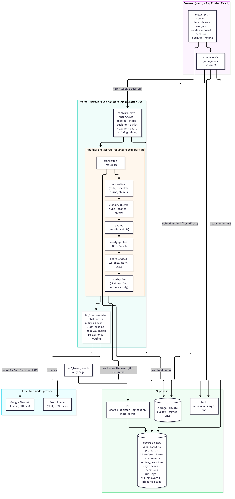
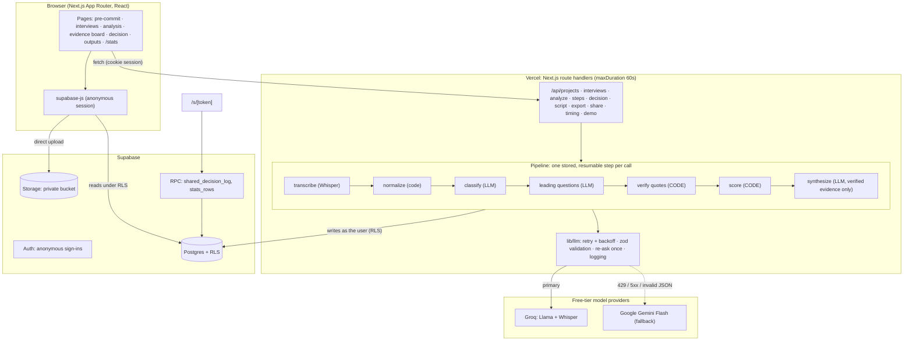

# Architecture

The diagram is generated from [`architecture.mmd`](architecture.mmd) with the Mermaid CLI (`npx mmdc -i docs/architecture.mmd -o docs/architecture.png -p docs/puppeteer.config.json -s 2`). The same diagram as Mermaid source:

## The idea in one paragraph

The language model is used only where language understanding is needed (classifying statements, spotting leading questions, writing themes and new questions). Everything that must be trustworthy is ordinary code: splitting and chunking transcripts, **verifying that each quote exists in the source**, **weighting and scoring the evidence**, enforcing the decision rules, and computing calibration. The model never sees raw transcripts during synthesis, only the verified, structured evidence.

## Request flow

1. **Auth.** The browser calls `signInAnonymously()` (Supabase). The session lives in cookies so route handlers can act *as the user*. There is no service-role key anywhere; every database call, in the browser or on the server, runs under Row Level Security.
2. **Uploads.** Files go straight from the browser to the private `interviews` bucket (avoids Vercel's request-body limit). A route handler then reads the file as the user, extracts text (`mammoth` for `.docx`) and creates the interview row. Audio is stored and transcribed later, inside the pipeline.
3. **Locking (Checkpoint 1).** `POST /api/projects/:id/analyze` sets `locked_at`. A database trigger (`projects_lock_guard`) makes the hypothesis and prediction immutable from then on, so the UI is not the only line of defence.
4. **Pipeline.** `analyze` writes one `pipeline_steps` row per (step, interview). The browser then calls `POST /api/projects/:id/steps` once per step, in order. Each call is short (≤ 60 s), its status is stored, and the UI polls the notes (such as "Rate limited by groq; retrying in 4s…"). A failed step shows a friendly message and **resumes from that step** on retry; completed steps are never redone.

   | Step | Per | Kind | What it does |
   |---|---|---|---|
   | transcribe | audio interview | Whisper (Gemini fallback) | audio → text |
   | normalize | interview | code | parse speaker turns, detect interviewer vs interviewee by labels and question ratio, ask the user if unclear |
   | classify | interview, per chunk | LLM | type, stance, rationale, exact quote per statement |
   | leading | interview | LLM | leading questions, why, neutral rewrite, possibly tainted answers |
   | verify | interview | **code** | fuzzy-match each quote against the transcript, snap it to the verbatim text, mark tainted answers |
   | score | project | **code** | weights, headline stat, strong evidence counts, per-interview support |
   | synthesize | project | LLM | themes, top 3 for / against (chosen from code-ranked candidates), open questions |

5. **Decision (Checkpoint 2).** `POST /api/projects/:id/decision` re-checks the friction rule on the server, computes calibration, stores an immutable decision (a trigger forbids edits) and a frozen log snapshot used for exports and sharing.
6. **Sharing.** The share link is an unguessable token on the decision row. The public page calls a `SECURITY DEFINER` function that returns only that frozen snapshot; the tables themselves stay private.

## LLM layer (`lib/llm`)

- `LlmAdapter` interface with `groq`, `gemini` and an offline `mock` implementation. Providers are tried in `LLM_PROVIDER_ORDER`.
- Per call: retry with exponential backoff on 429, 5xx and network errors (honouring `retry-after`, but never waiting beyond 15 s, so a daily quota falls back immediately); then fall back to the next provider.
- Every answer is parsed as JSON and validated with a zod schema. If invalid, the model is **re-asked once** with the validation error; if still invalid, the next provider is tried.
- Every call is logged to `run_logs` (provider, model, tokens in/out, latency, success). That table feeds `/stats` and the AI disclosure.
- Prompts are versioned constants in `lib/prompts` (`classify@1.0.0`, …); the versions used are stored with each synthesis.

## Verification layer (`lib/text/match.ts`, `lib/verify.ts`)

Quotes are tokenised into words (case, punctuation and whitespace ignored). A quote is accepted if it matches an exact word sequence in a turn spoken by the right role, or, for quotes of at least 3 words, a fuzzy window with word-level similarity ≥ 0.88. The stored quote is replaced by the verbatim transcript text and its offsets are saved so the transcript view can highlight it. Unverified statements are excluded from every number and shown only in a collapsed "excluded" list. An interviewee quote cannot be verified against interviewer speech.

## Scoring (`lib/scoring.ts`)

Weights: past behavior 1.0, current pain 0.7, future promise 0.25, general opinion 0.15, compliment 0. A statement that follows a verified leading question is multiplied by 0.4 ("tainted"). *Strong evidence* = weight ≥ 0.7 (untainted past behavior or current pain). The headline percentage is `(compliments + promises) / positive-sounding statements`, where positive-sounding means stance *supports* or type *compliment*. An interviewee "supports" when strong supporting statements outnumber strong counter-statements and the weighted evidence for exceeds the weighted evidence against.

## Data model

`projects`, `interviews`, `turns`, `statements`, `leading_questions`, `syntheses`, `decisions`, `run_logs`, `timing_events` plus `pipeline_steps` (added for resumability). Every table has `owner_id` with RLS policies; child-table inserts also require that the parent project belongs to the caller. See `supabase/migrations/`.

## Where each guarantee lives

| Guarantee | Enforced by |
|---|---|
| Users only see their own rows | RLS policies on every table (tested in `tests/rls.test.ts`) |
| Hypothesis/prediction immutable after analysis starts | DB trigger + API check |
| Quotes are real | code verification before any score |
| Scores are not LLM opinions | `lib/scoring.ts` |
| Friction before Validated/Invalidated | `lib/decision.ts` on the server and in the UI |
| Decision cannot be edited | DB trigger |
| Files are private | private bucket + owner-prefix storage policies |
